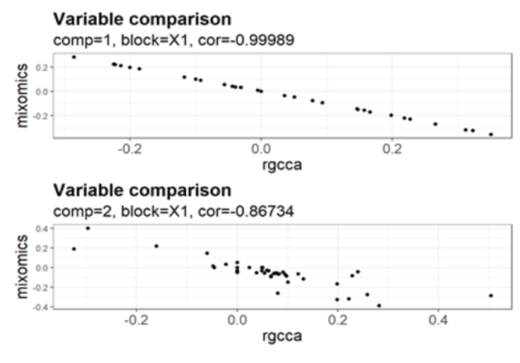
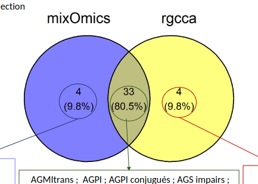

# Introduction

In a world where data collection and analysis are becoming increasingly complex, multidimensional statistical methods (@bersanelli2016methods) play a crucial role in understanding the phenomena under study. These methods encompass a variety of approaches: exploratory or supervised factor analysis, unsupervised classification methods, etc. In particular, methods derived from partial least squares (PLS) regression are extensively used in biological, medical, and other applications. Of particular note are its discriminant version (“DA” for Discriminant Analysis) and the version designed for variable selection (“sparse”), as well as the multiblock methods derived from them, either with regularization (RGCCA for Regularized Generalized CCA (@Tenenhaus_Tenenhaus_2011), or with variable selection (sGCCA for sparse Generalized CCA (@Tenenhaus2014).


These methods are implemented in R, but the wide variety of tools available for applying a single method leads users to question their differences in terms of functionality, maintenance, reproducibility, and results. In particular, `RGCCA` (@girka2023multiblock) and `mixOmics` (@mixomics) are two complex data integration packages with very similar functionalities. The mixOmics package is one of the most widely used (2,500 to 3,000 package downloads per month). In addition, the RGCCA package has just been updated with new features. The functions in the original mixOmics package were built on top of the RGCCA package and modified to simplify their use by biologists. 
In this context, our project aimed to compare the RGCCA and mixOmics packages across various aspects (algorithms, input and output data, parameters, interpretation aids, etc.). The comparison was also performed on real datasets.

# Material and methods

The methods compared are as follows: PLS, PLSDA, multiblock PLS (MB-PLS), and MB-PLSDA, as well as their sparse versions.

## (Multi-block) (s)PLS(DA)

Let $X = [X_1, \cdots, X_j, \cdots, X_J] \in \mathbb{R}^{n \times p}$ ($J \geq 2$). Each matrix $X_j$, of size $n \times p_j$, is called a "block" and represents a set of $p_j$ variables observed on the same set of $n$ individuals. The number of variables may differ from one block to another, but the individuals are the same for all blocks. The variables are assumed to be centered. The optimization problems for mixOmics (1) and RGCCA (2) are defined respectively by:

$$
\begin{aligned}
& \max_{w_1, \cdots, w_J} \; \sum_{j,k}^{J} c_{jk}\, g\!\left( \operatorname{cov}\!\left( X_j w_j, X_k w_k \right) \right) \\
& \text{under constraints } \left\| w_j \right\|_2^2 = 1 \text{ and } \left\| w_j \right\|_1 \leq s
\end{aligned}
$$ {#eq-mixomics}

$$
\begin{aligned}
& \max_{w_1, \cdots, w_J} \; \sum_{j,k}^{J} c_{jk}\, g\!\left( \operatorname{cov}\!\left( X_j w_j, X_k w_k \right) \right) \\
& \text{under constraints } (1 - \tau_j)\operatorname{var}\!\left( X_j w_j \right) + \tau_j \left\| w_j \right\|_2^2 = 1 \text{ and} \\
& \left\| w_j \right\|_1 \leq s \text{ for sparse models}
\end{aligned}
$$ {#eq-rgcca}

where:

-   the design matrix $C = \{c_{jk}\}$ is a symmetric $J \times J$ matrix of non-negative elements describing the network of connections between the blocks, where $c_{jk} = 1$ between two connected blocks and 0 otherwise;

-   the function $g$ is a continuous, differentiable, convex function;

-   the regularization parameters (RGCCA only), denoted by $\tau_j$, are in the range 0 to 1 and interpolate between covariance and correlation;

-   $w_j$ is the block weight vector;

-   $s$ is the sparsity parameter.

## Algorithm comparison

The first step was to study these methods from a theoretical perspective (optimization problem, initialization, deflation, block weighting, regularization, variable selection method, handling of missing values, prediction methods). Their implementations in the two packages were compared (inputs and outputs of the main functions, functions for adjusting or evaluating the models, graphs).

At the same time, comparison criteria were established and datasets were prepared using real data from research projects, prior to applying the functions and comparing the results. These steps are described in @fig-workflow, along with the functions we developed to (i) parameterize and build the models, (ii) predict and estimate the performance of the resulting models, and (iii) display a number of comparison graphs.

TODO : compléter la figure (sur mermaid.live)

```{mermaid}
%%| label: fig-workflow
%%| fig-cap: "Workflow d'analyse"
flowchart LR
    X1[" "]
    X2[" "]
    X3[" "]
    M[" "]

    X1 --> M
    X2 --> M
    X3 --> M

    M ==> B

    B["<b>Configure & build<br/>models</b>
    <pre>run_mixomics_rgcca()</pre>"]

    B ==> V
    B ==> C

    V["<b>Validate, assess<br/>performance of models</b>
    <pre>run_perf_mixrgcca()<br/>rend_perf_table()</pre>"]

    C["<b>Compare models</b>
    <pre>compare_criteres()<br/>compare_rmse()<br/>compare_selected_vars()<br/>compare_stability()</pre>"]

    classDef data fill:#fff,stroke:#000,stroke-width:1px;
    classDef merge fill:#fff,stroke:#000,stroke-width:1px;
    classDef step fill:#fff,stroke:#2bb5b8,stroke-width:2px,color:#000;

    class X1,X2,X3 data;
    class M merge;
    class B,V,C step;
```

## Application to a dataset

This evaluation was based on the results obtained using data from the BestDairy project (INRAE Syalsa Metaprogram, 2021). This project aimes to show how livestock management practices and technologies influence milk composition. It provides a proof of concept for the multi-criteria divergence in the qualities of raw milk and the environmental impact of its production conditions during the rearing phase, the various dairy products derived from it (aged cheeses or fermented milks), sensory perception, and consumer health---particularly through probiotic enrichment. Among the available data, several matrices are derived from measurements of individual milk samples, with a wide range of variables (from 11 to 693). In this presentation, we will illustrate some results using MB-sPLS applied to three datasets measured on 37 milk samples from different cows: $X_1$ consisting of 89 lipids, $X_2$ consisting of 11 oligosaccharides, and $Y$ comprising 22 major proteins.

To ensure the comparability of the multi-block functions, identical or the closest possible parameters were used for both methods (centered-reduced variables, no block weighting, etc.). The spasity parameters were chosen arbitrarily for RGCCA, and the number of variables obtained was specified for the model derived from mixOmics. To establish relationships between individual scores, the correlation coefficients between the first RGCCA and mixOmics components were calculated (axes 1 and 2). Similarly, the correlations between the variable weights were also calculated.

# Results and discussion

## Implementation comparison

The main conceptual differences identified come from the fact that different parameters were defined by the developers or left to the user's choice.

For example, mixOmics offers up to four PLS deflation modes, whereas RGCCA offers only one. However, by default, RGCCA makes blocks comparable by accounting for their size through weighting. We believe that applying this weighting would be more accurate and relevant in the context of multiblock analysis and would justify the use of the term MB-(s)PLS(DA). Furthermore, it offers greater flexibility for multiblock analysis thanks to its optimization problem, which allows the selection of the regularization parameter $\tau$ and the convex function $g$. It also allows for different numbers of components per data block.

Regarding variable selection based entirely on Lasso penalization, RGCCA uses a sparsity parameter $s$, whereas mixOmics uses a number of variables. To set this parameter, RGCCA uses permutation-based approaches (unsupervised case) or cross-validation (supervised case) to select the sparsity parameters. mixOmics uses cross-validation to select, per block and per component, the optimal number of variables. Both methods use a user-defined grid.

Another major difference concerns prediction, particularly for the "DA" multiblock versions. RGCCA allows users to apply all the models offered by the caret package by concatenating all the latent variables obtained from the model. In contrast, mixOmics performs independent block-wise predictions based on distance-based approaches and then uses majority voting.

The packages also differ in terms of a few useful options. For example, mixOmics offers log-ratio transformation for compositional data and the `multilevel` argument to correct for the individual effect in repeated measures data.

## Application à des données réelles

En fixant arbitrairement les paramètres de parcimonie de **RGCCA**, nous sélectionnons 31 et 37 variables pour les deux premières composantes de $X_1$ ; 4 et 5 variables pour $X_2$. Ces valeurs ont ensuite été imposées dans le modèle de **mixOmics**. Nous avons calculé les corrélations entre les scores des individus, ainsi qu'entre le poids des variables pour un bloc et une composante dans le cadre d'une MB-sPLS. La première composante de chaque bloc semble assez comparable entre les deux packages avec des corrélations à $\pm 1$ ou assez proches de $\pm 1$. Des différences commencent à apparaître à partir de la seconde composante. Par exemple, la corrélation entre le score des individus pour le bloc $Y$ est de $-0.88$ et celle entre le poids des variables pour le bloc $X_1$ est à $-0.87$ (@fig-corr). En ce qui concerne la sélection des variables, nous observons quelques différences, notamment pour la composante 2 du bloc $X_1$ avec 4 variables sélectionnées spécifiquement par chaque package (@fig-selection).

TODO : la figure sera à faire avec le code R (pas de figure insérée !!)



TODO : la figure sera à faire avec le code R (pas de figure insérée !!)



Les écarts observés dès la seconde composante, et probablement accentués sur les axes suivants, s'expliquent en partie par des différences entre les méthodes de déflations des deux packages. Des travaux ultérieurs pourraient permettre d'investiguer cette piste et de fournir des recommandations à ce sujet.

Des modèles MB-sPLSDA ont également été appliqués pour ces mêmes données avec une variable qualitative à expliquer décrivant les pratiques d'élevage, avec des conclusions similaires à la MB-sPLS.

## User support

For non-expert users, mixOmics appears to be more suitable due to its ease of use and the availability of numerous support resources, such as a reference book (@le2021multivariate), a website rich in examples, a forum where users can ask questions, and regularly organized training sessions. Regarding RGCCA, @girka2023multiblock have written a comprehensive guide on how to use the package.

# Conclusion

Our goal was to provide a comprehensive and unified framework for comparing and explaining PLS-type methods and their variants---including discriminant, multiblock, and sparse analyses---from the R packages RGCCA and mixOmics.

For a simple initial approach, the mixOmics package seems more appropriate. However, it includes a number of default settings that users must pay attention to, particularly to ensure that the desired method is indeed applied. RGCCA offers a more flexible, customizable framework and provides a wider variety of multiblock approaches. It is therefore better suited for an expert audience. Currently, the packages continue to evolve to incorporate useful options or new approaches.


# References {.unnumbered}

<!-- Métaprogramme Syalsa INRAE, 2021. *BestDairy, Optimisation de la composition des laits et de la qualité nutritionnelle et sensorielle des produits laitiers par les pratiques d'élevage des vaches laitières (amont) et l'ajout de ferments (aval) (2021-2023).* -->

::: {#refs}
:::

# Session information {.appendix .unnumbered}

```{r session-info}
sessionInfo()
```

